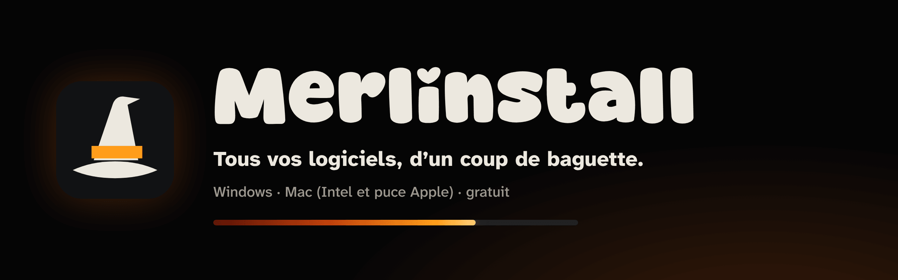
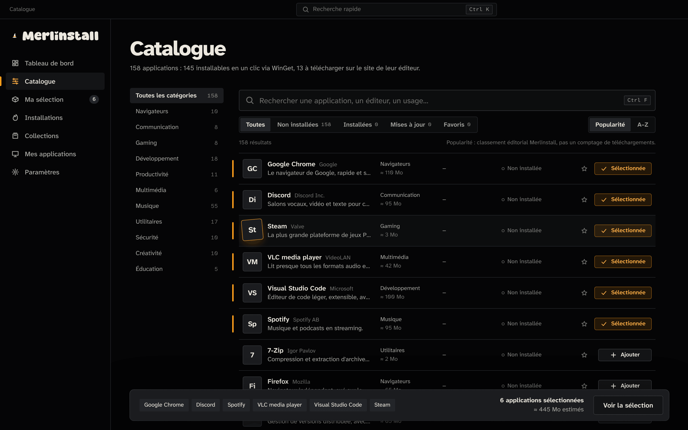
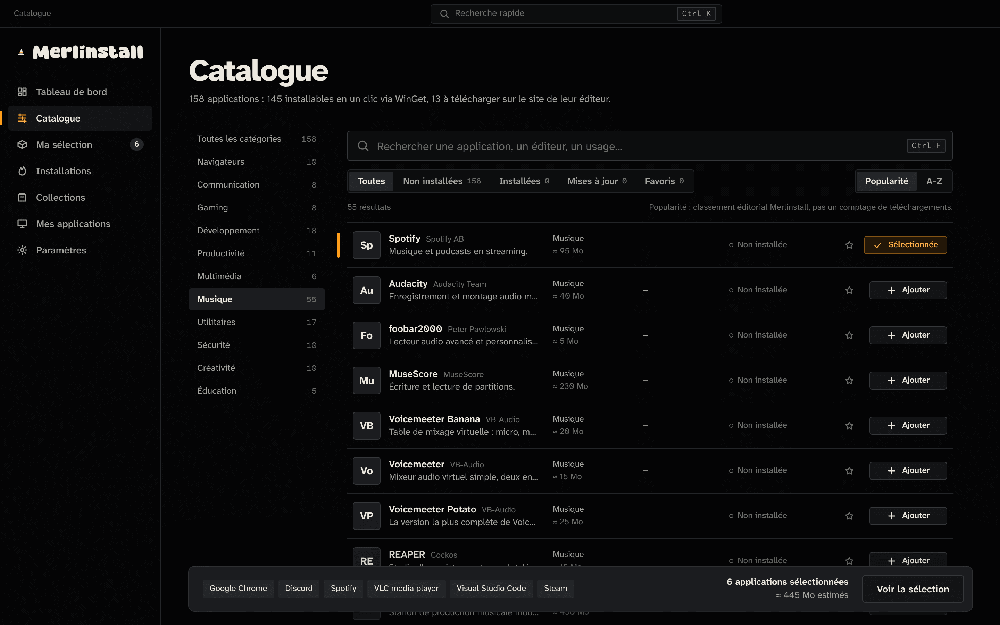
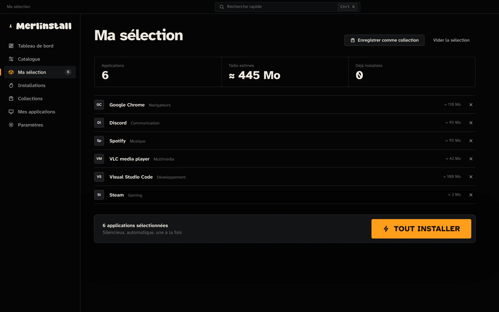
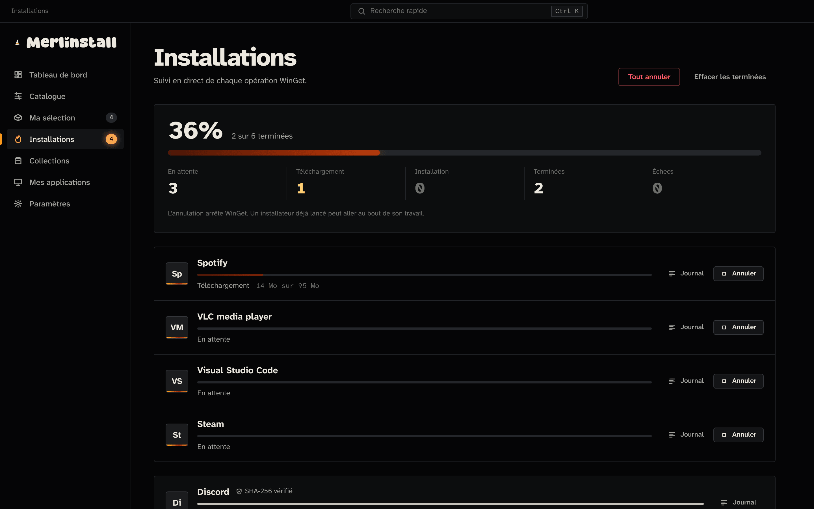
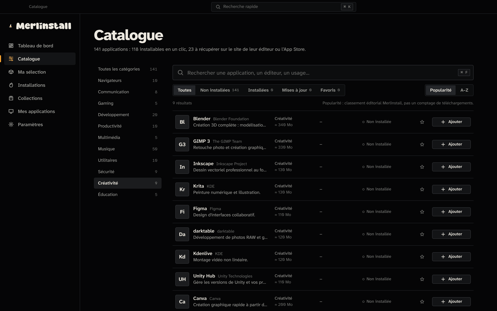

  

  <a href="https://github.com/Merlin-OS/MerlInstall/releases/download/v0.1.0/Merlinstall_0.1.0_x64-setup.exe"><b>⬇ Télécharger pour Windows</b></a>
  &nbsp;·&nbsp;
  <a href="https://github.com/Merlin-OS/MerlInstall/releases/download/Merlinstall_Mac_0.1.0/Merlinstall_0.1.0_universal.dmg"><b>⬇ Télécharger pour Mac</b></a>
  &nbsp;·&nbsp;
  <a href="https://github.com/Merlin-OS/MerlInstall/releases">Toutes les versions</a>

---

Merlinstall installe tous vos logiciels en une seule opération. Choisissez vos applications dans le catalogue, cliquez sur **Tout installer**, et suivez chaque installation en direct.

- **158 logiciels sur Windows, 141 sur Mac**, rangés en 11 catégories : navigateurs, jeux, développement, musique, création…
- **Collections prêtes à l'emploi** (Essential, Gaming, Developer, Music…) et collections personnelles, pour réinstaller un ordinateur en un clic.
- **Suivi en direct** : téléchargement, vérification, installation, puis mises à jour détectées automatiquement.
- **Sûr** : chaque téléchargement vient de la source officielle et son empreinte SHA-256 est vérifiée avant l'installation.

## Aperçu

<table>
  <tr>
    <td width="50%"> <b>Tableau de bord</b> : votre parc d'applications en un coup d'œil.</td>
    <td width="50%"> <b>Musique</b> : plus de 50 logiciels pour créer, mixer et écouter.</td>
  </tr>
  <tr>
    <td width="50%"> <b>Collections</b> : des packs prêts à installer, et les vôtres.</td>
    <td width="50%"> <b>Ma sélection</b> : tout installer d'un seul bouton.</td>
  </tr>
  <tr>
    <td width="50%"> <b>Installations</b> : progression en direct, empreinte vérifiée.</td>
    <td width="50%"> <b>Sur Mac</b> : même interface, raccourcis ⌘, Intel et puce Apple.</td>
  </tr>
</table>

Captures de l'interface réelle. Les logos des éditeurs, affichés par l'application quand elle est connectée, sont remplacés ici par leurs initiales.

## Installation

### Windows 10 / 11

1. Téléchargez [`Merlinstall_0.1.0_x64-setup.exe`](https://github.com/Merlin-OS/MerlInstall/releases/download/v0.1.0/Merlinstall_0.1.0_x64-setup.exe) et lancez-le.
2. Windows affiche « Windows a protégé votre ordinateur », parce que l'application n'est pas encore signée : cliquez sur **Informations complémentaires**, puis **Exécuter quand même**.

Merlinstall utilise WinGet, le gestionnaire officiel de Microsoft, déjà présent sur la plupart des PC (« Programme d'installation d'application » du Microsoft Store).

### Mac (macOS 11 ou plus récent, Intel et puce Apple)

1. Téléchargez [`Merlinstall_0.1.0_universal.dmg`](https://github.com/Merlin-OS/MerlInstall/releases/download/Merlinstall_Mac_0.1.0/Merlinstall_0.1.0_universal.dmg), ouvrez-le et glissez **Merlinstall** dans **Applications**.
2. Au premier lancement, macOS bloque l'app, parce qu'elle n'est pas encore validée par Apple : ouvrez **Réglages Système › Confidentialité et sécurité**, descendez et cliquez sur **Ouvrir quand même**.

Homebrew n'est pas nécessaire : sans lui, Merlinstall installe les applications lui-même. Les outils en ligne de commande (git, Node.js, Python…) demandent en revanche Homebrew, qui ne s'installe plus sur les Mac Intel.

## Sécurité et vie privée

- **Sources officielles uniquement** : WinGet sur Windows, catalogue Homebrew sur Mac. Les téléchargements en HTTP non chiffré sont refusés.
- **Empreinte SHA-256 vérifiée** avant chaque installation. Sur Mac, une application sans empreinte publiée doit avoir une signature Apple valide.
- **Aucun contournement** des protections de Windows ou de macOS : Gatekeeper et le contrôle de compte restent actifs, et le mot de passe administrateur est toujours demandé par le système, jamais par Merlinstall.
- **Aucune télémétrie** : pas de compte, pas de statistiques, rien n'est envoyé à l'auteur.

## Version de test

Merlinstall 0.1.0 est une première version. Un bug, une application à ajouter, une idée ? Ouvrez une [Issue](https://github.com/Merlin-OS/MerlInstall/issues).
